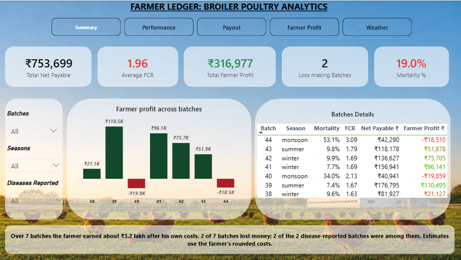
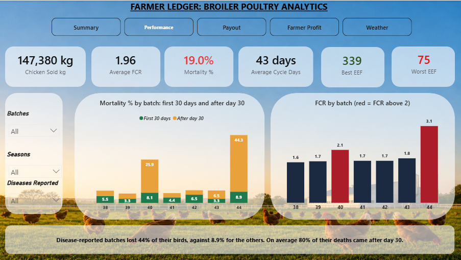
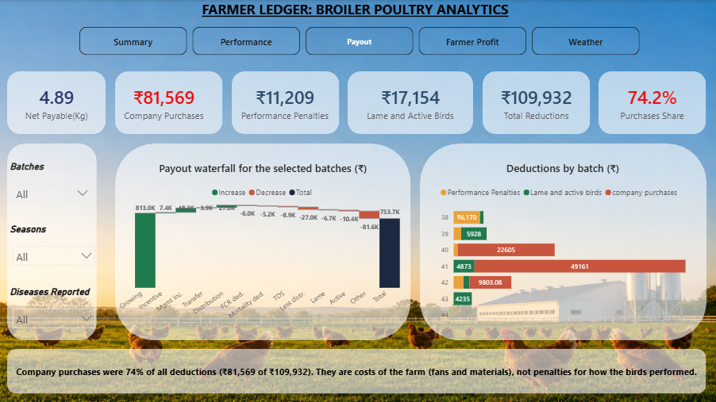
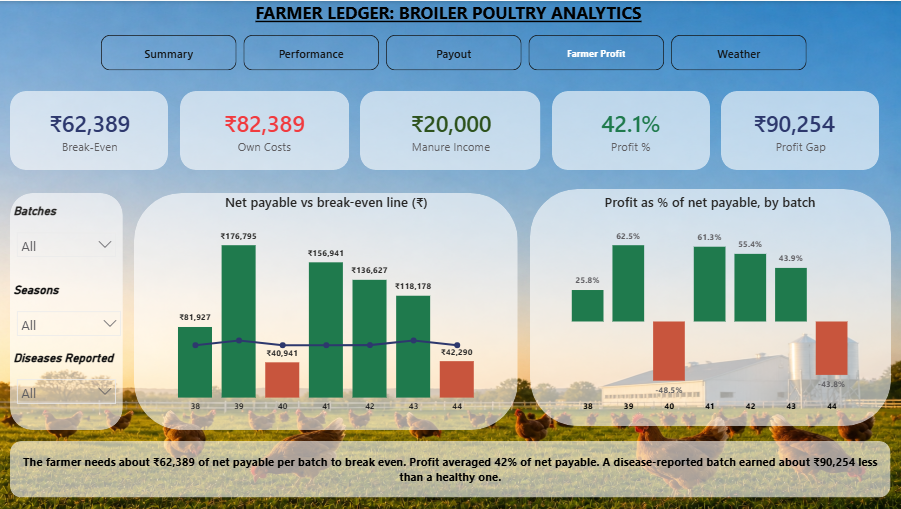
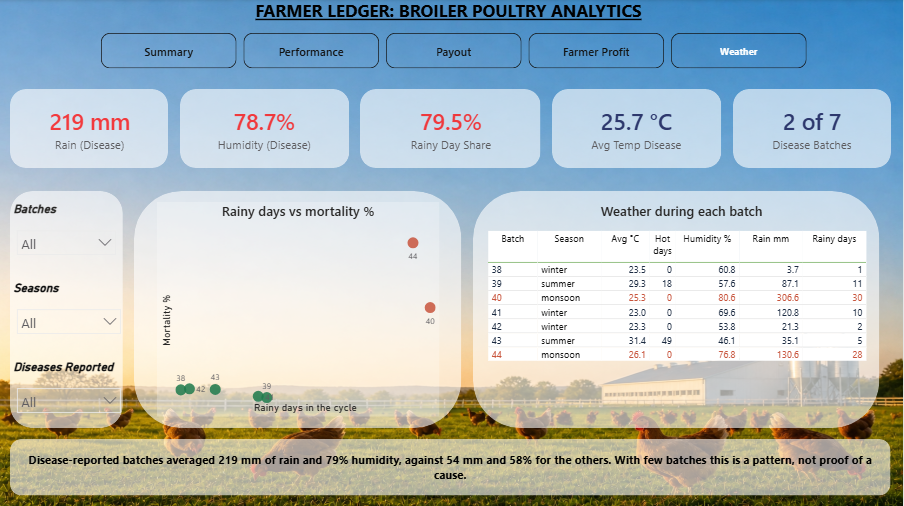
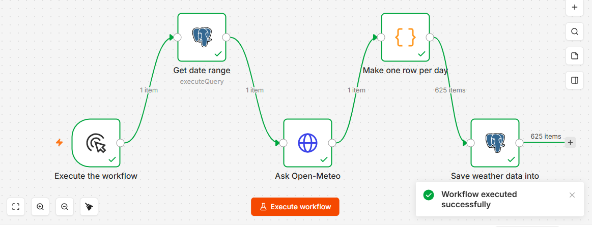

# FarmLedger: Contract Broiler Profitability and Statement Automation

A data project built from real growing charge statements of a contract broiler (meat chicken) farm in Telangana, India: 7 batches, December 2024 to August 2026. It turns paper statements into a checked PostgreSQL database, shows what the farmer really earns after his own costs, relates weather and season to batch results, and (planned) automates adding new statements.

**Stack:** Excel (source data) → PostgreSQL → Power BI, with n8n for automation and weather data. Git for version control.

---

## Why this project

In contract broiler farming, a company supplies chicks, feed and medicines, and the farmer provides the shed, labour, electricity and water. After each batch the farmer receives a growing charge statement with performance numbers and a payout. The statements arrive on paper, so nobody could easily see why some batches paid far more than others, or whether the farmer made a profit after his own costs.

## Business questions and answers

| # | Question | Answer in short | Status |
|---|---|---|---|
| 1 | Why did some batches perform badly, and when did the losses happen? | Batches 40 and 44 had 34% and 53% mortality; about 80% of their deaths came after day 30. | Answered |
| 2 | What does the farmer really earn per batch, where is break-even, and how much do manure earnings cover? | Estimated profit totals ₹3,16,977 over 7 batches. Break-even is about ₹60,800 of net payable (₹66,300 in summer). Manure income covers about a quarter of own costs. | Answered |
| 3 | How much of the payout is lost to deductions, and how much of that is company purchases? | Total reductions ₹1,09,932, of which company purchases (fans, materials) are ₹81,569 (74%). | Answered |
| 4 | How do season and weather relate to results? | The two disease-reported batches were the wettest and most humid; no batch had a day above 35 °C in those two. Pattern only. | Answered (pattern, not proof) |
| 5 | How much does a disease-reported batch cost the farmer? | Average estimated profit: ₹71,069 for the other five batches against -₹19,185 for the two disease batches, a gap of about ₹90,254. | Answered |
## Dashboard (Power BI)

Five pages, with automatic summary text that updates when batches are added. Charts and tables show the latest 8 batches; cards use all batches.

**1. Summary**




**2. Performance**




**3. Payout**




**4. Farmer profit**




**5. Weather**




A PDF export of the report is in [text](powerbi/FarmLedger_dashboard.pdf). The `.pbix` file is not published because it contains an imported copy of the data.

## Key findings

- **Two batches lost money.** Batches 40 and 44 (disease reported by the farmer) had an estimated profit of -₹19,859 and -₹18,510. The other five batches earned between ₹21,127 and ₹1,10,495.
- **The losses came late.** In the disease batches, about 80% of deaths happened after day 30, compared with about 48% in the others.
- **Most deductions are not penalties.** Of ₹1,09,932 taken from payouts, ₹81,569 (74%) were company purchases such as industrial-fans and materials; performance penalties were ₹11,209.
- **Weather.** Both disease-reported batches ran in the monsoon, with an average of 219 mm of rain and 78.7% humidity, against 54 mm and 57.6% for the others. Heat is not supported: neither had a day above 35 °C.
- **Data quality.** All 7 batches reconcile to the printed net payable.

## Architecture

```
Paper statement
      |  (typed and checked cell by cell into Excel)
      v
Excel master file ----> PostgreSQL (13 tables, 8 views, 6 reconciliation checks)
                              ^
Open-Meteo weather API --> n8n workflow (625 days, upsert) 
                              |
                              v
                        Power BI dashboard (5 pages)
```

Planned: an n8n flow where a vision AI model reads a new statement, the same checks validate it, good records are saved and failed ones go to a review queue.

## Database

- **Core tables:** `dim_batch`, `fact_batch`, `fact_cost_line`, `fact_payout_line`, `dim_scheme`, `dim_cost_item`, `dim_payout_item`, `batch_event`, `farm_assumption`, `review_queue`
- **Calendar and weather:** `season_month`, `dim_date`, `fact_weather_day`
- **Design choices:**
  - Payout lines are rows, not columns, so a new kind of line is a new row.
  - The sign (+1 or -1) of each payout line lives only in `dim_payout_item`, so it cannot be mistyped in the data rows.
  - Primary keys, foreign keys and CHECK rules stop duplicates, orphan rows and impossible values.
  - The load script is safe to run twice (`ON CONFLICT DO UPDATE`) and runs as one transaction.
- **Views:** reconciliation checks (`v_batch_checks`, `v_batch_checks_summary`), KPIs (`v_batch_kpis`), farmer profit (`v_farmer_profit`), batch days and weather (`v_batch_days`, `v_batch_weather`), and two views made for Power BI (`v_batch_analysis`, `v_payout_waterfall`).

### Reconciliation checks

Each batch is tested for: payout lines add up to net payable; feed issued + feed in − feed out = consumption; cost lines add up to the total; housed − mortality + excess − shortage = sold; mortality %; FCR.

## Automation (n8n)

The workflow [`n8n/weather_loader.json`](n8n/weather_loader.json) reads the date range of all batches from the database, requests daily weather from Open-Meteo, reshapes it to one row per day, and upserts 625 days into `fact_weather_day`.




## How to reproduce

1. Install PostgreSQL, create a database named `farmledger`.
2. Run the SQL files in `sql/` in this order: `create_tables_01`, `load_data_02`, `views_03`, `farmer_profit_04`, `calendar_05`, `weather_table_06`, `weather_view_07`, `batch_analysis_08`. (`analysis_queries.sql` holds extra example queries.)
3. Install Node.js 22 and n8n (`npm install -g n8n`), create a Postgres credential, import `n8n/weather_loader.json`, and run it.
4. In Power BI Desktop, connect to PostgreSQL (database `farmledger`) and load `v_batch_analysis`, `v_payout_waterfall` and `dim_date`.

## Data and privacy

- The source Excel files are not published. Bank, tax and address details from the statements were never stored.
- `sql/load_data_02.sql` currently holds the real batch values; it was replaced by a masked sample before this repository is made public.
- Farm costs (electricity, labour, rice husk, charcoal, soil) and manure income are the farmer's estimates, stored in the `farm_assumption` table. Manure is valued at ₹2,000 per tractor load.

## Limitations

- Only 7 batches from one farm, so no predictive modelling and no statistical claims.
- Costs are rounded estimates, so profit figures are approximate.
- Disease is reported by the farmer and regional supervisor but not lab-confirmed, and the data does not prove a cause. Both disease batches also ran in the same season.
- Weather is for the surrounding area, not inside the shed.
- Net payable is after the 1% TDS; profit excludes repairs, loan payments, depreciation and family labour.

## Roadmap

- [x] Master data checked against the paper statements
- [x] PostgreSQL schema, load script, checks and views
- [x] Calendar, season and daily weather (n8n + Open-Meteo)
- [x] Power BI dashboard
- [ ] AI-assisted statement reader in n8n with validation and a review queue

## Credits

Weather data by [Open-Meteo.com](https://open-meteo.com/).

## About AI assistance

AI assistants helped draft and review code and documentation. Data collection and checking, design decisions, the business questions and the analysis are my own work.

### Connect with Me

- GitHub: https://github.com/Abhinayreddy43
- LinkedIn: (https://www.linkedin.com/in/abhinayreddytippireddy/)

---

<div align="center">

### ⭐ If you like this project, consider giving it a star!

Thank you for visiting my repository.

</div>
